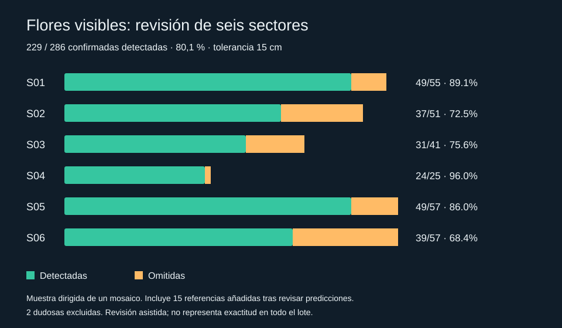
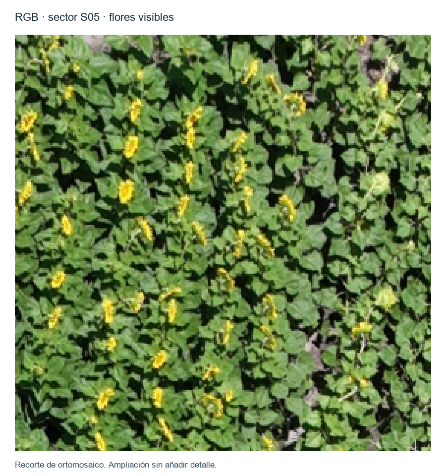
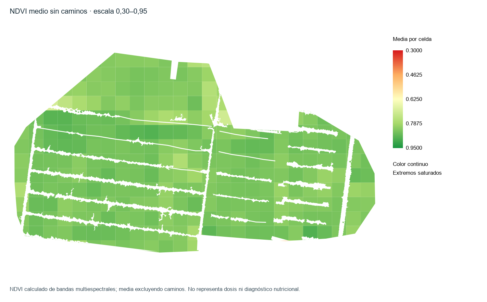

# Sunflower Flower Detection in RGB Drone Imagery to Support Phenological Monitoring

A case study in classical computer vision and geospatial analysis with WebODM, Python and QGIS, aimed at supporting phenological monitoring of sunflower during flowering. This version locates flower heads with visible yellow petals in an RGB orthomosaic from a single flight date and evaluates the detections against manual annotation.

## Executive summary

- **What it is:** a sunflower flower detector for RGB drone orthomosaics, based on color segmentation (HSV) and spatial filtering of candidates.
- **Agronomic goal:** explore the detection and spatial distribution of visible flowers as a basis for monitoring flowering progress.
- **Stack:** WebODM (orthomosaic generation) → Python / GDAL / NumPy / SciPy (detection) → QGIS / PyQGIS (review and geospatial analysis).
- **Key result:** 80.1% recall (229 of 286 confirmed flowers) across six sectors, using detection-assisted review.
- **What it demonstrates:** processing of georeferenced imagery, design of a color-based detector with spatial filtering, and a one-to-one evaluation protocol that preserves both the initial and the corrected results.



## Agronomic goal and practical application

The goal is to explore the use of RGB drone imagery to support monitoring of sunflower phenological progress during flowering, by identifying visible flowers and their spatial distribution. The detection map can help select sectors for field inspection.

This project analyzes a single flight date as a first approximation. Comparing successive flights would make it possible to study changes in flowering, provided that capture conditions remain comparable and results are validated with field observations.

What is evaluated here is the detection of visible flowers on that date. Temporal evolution has not yet been measured, no phenological stage has been assigned to individual plants, and the percentage of plants in flower has not been estimated, because the full set of plants was not counted.

## Workflow

Drone images → WebODM processing → GeoTIFF orthomosaics → Python/QGIS analysis → manual review and GIS outputs.

The scripts in this repository start from the processed products; they do not automate or reproduce the WebODM stage.

## Data and tools

- RGB orthomosaic generated with WebODM from drone images. Approximate pixel size: 1.5 cm (this does not imply 1.5 cm positional accuracy).
- Analysis coordinate system: a projected CRS in meters. The zone and geographic coordinates are omitted from the public version.
- QGIS and PyQGIS: visual review, vector layers and manual annotation.
- GDAL, NumPy, SciPy and RGB–HSV conversion: raster reading, color segmentation and spatial comparison.
- GeoPackage: storage of detections, sectors and references.

The mosaic contains distorted areas and regions without usable detail. The review was limited to six visually legible sectors.

## Project images



Crop of the orthomosaic used to recognize visible yellow flowers.



Complementary analysis using the mean NDVI layer with roads masked out (scale 0.30 to 0.95). It did not take part in the RGB detector; the broader agricultural project also included NDVI/NDRE and zoning exercises, kept separate.

## Detection method

1. Read the RGB raster in blocks, with overlap so block edges are processed correctly.
2. Identify yellow pixels in HSV space, combining saturation, brightness and red/blue ratio constraints.
3. Apply morphological closing and extract connected components.
4. Filter components by size and compute their centroids.
5. Convert centroids to map coordinates and restrict them to the working boundary.
6. Apply spatial suppression: keep candidates with the largest yellow area first and discard candidates within 20 cm of one already kept.

### Run parameters

| Parameter | Value |
|---|---|
| Block and margin | 1000 × 1000 pixels; 40-pixel margin |
| HSV hue, 0–1 scale | 0.10 < H < 0.19 |
| Saturation and brightness | S > 0.48; V > 0.52 |
| Channel ratio | R > 1.6 × B |
| Morphological closing | 1 iteration |
| Component area | 5–250 pixels |
| Maximum component dimension | 35 pixels |
| Spatial separation | 0.20 m |

The extended run produced 3,711 candidates; spatial filtering kept 3,359 (these are candidates, not a validated count of flowers in the field).

## Review protocol

Six sectors of 280 × 280 pixels (~4.2 × 4.2 m each) were selected visually and deliberately, not at random.

The user marked flower centers with the automatic detections hidden, and could flag doubtful references. The initial comparison used one-to-one matching (main tolerance of 15 cm; results at 10 and 20 cm were also computed). Afterwards, the detections without a reference were displayed and the user confirmed 15 of them as flowers missed during annotation, which were added with a note on their provenance. Initial results and backups of the references were preserved. The detector parameters were not changed during the review.

## Results

### Initial comparison with manual marks

At 15 cm tolerance: 271 visible references, 214 matches, 15 detections without a reference and 57 references without a match. Precision: 93.4%. Recall: 79.0%.

### References corrected after user review

| Sector | Confirmed flowers | Detected | Missed | Recall |
|---|---:|---:|---:|---:|
| S01 | 55 | 49 | 6 | 89.1% |
| S02 | 51 | 37 | 14 | 72.5% |
| S03 | 41 | 31 | 10 | 75.6% |
| S04 | 25 | 24 | 1 | 96.0% |
| S05 | 57 | 49 | 8 | 86.0% |
| S06 | 57 | 39 | 18 | 68.4% |
| **Total** | **286** | **229** | **57** | **80.1%** |

Two doubtful references were excluded from the calculation. The overall percentage is computed on the sum of flowers, not as a simple average across sectors.

## Reproducibility

The detector was re-run on the full mosaic and the original boundary: it reproduced the 3,711 candidates and the 3,359 filtered points. The local verification compared both layers against the historical ones: one-to-one correspondence of all points, identical component areas and a maximum coordinate difference of 2.91 × 10⁻¹¹ m (numerical rounding). See `results/detector_reproduction.json`.

The evaluation was checked against the historical counts for the six sectors at 10, 15 and 20 cm (18 comparisons), plus four additional tests covering duplicates, maximum cardinality, absence of detections and doubtful references.

### Run the detector

```bash
python -m pip install -r requirements-detector.txt
python scripts/detect.py --rgb /path/orthophoto.tif --boundary /path/boundary.gpkg --output /path/detections.gpkg
```

Expects RGB in bands 1–3 and an optional alpha channel in band 4, a raster with no grid rotation, and a projected CRS in meters. The output contains `candidates` and `filtered` layers; existing GeoPackages are never overwritten. Requires GDAL (for example, the QGIS/OSGeo Python environment); `requirements-detector.txt` lists the additional dependencies.

### Run the evaluation

```bash
python -m pip install -r requirements.txt
python scripts/evaluate.py data/initial_samples.json --output results/initial_run.json
python scripts/evaluate.py data/reviewed_samples.json --output results/reviewed_run.json
python -m unittest discover -s scripts -p "test_*.py"
python scripts/make_figure.py
```

Points use meters relative to an origin specific to each sector: they preserve distances for comparison but contain no geographic coordinates.

## Evidence available locally

In the working project, `revision_multiespectral/validacion_flores/` contains:

- `sectores_validacion.gpkg`: sector polygons S01–S06.
- `flores_referencia_manual.gpkg`: references, statuses and correction notes.
- `evaluacion_S01.json` to `evaluacion_S06.json`: initial comparisons and tolerances.
- `evaluacion_S*_revisada.json`: assisted corrections where applicable; S05 required no correction.
- `revision_S01.gpkg` to `revision_S06.gpkg`: review layers.
- `resumen_seis_sectores_final.json`: final summary.

These files are not yet included in this directory.

## Limitations and scope

- A flower that was not detected does not imply a plant without a flower: foliage, flower head orientation, shadows and mosaic defects can hide it. The full set of plants was also not individually identified.
- The corrected review is assisted by the predictions and is not an independent blind evaluation. References were corrected while viewing the predictions, come from a single mosaic, and there is no independent count of all flowers present.
- The six sectors were selected visually and deliberately; they are not random nor representative of other flights.
- This detector uses color segmentation and spatial filtering; it does not use deep learning.
- The full data and the photogrammetric reconstruction from the original photographs are not included; the sample points are not sufficient images or labels to train a visual detector.
- The detector was verified in the local QGIS environment with GDAL 3.12.2; portability across all systems is not claimed.
- An independent evaluation with complete annotations on a different flight would be a natural next step to study generalization.

## Related project

**Building footprint extraction with Mask R-CNN on SpaceNet 2**

An instance segmentation project on satellite imagery, covering training, evaluation and conversion of predictions into GIS-compatible polygons.

Together, the two projects show complementary skills: color-based detection and drone image analysis on sunflower; deep learning and geometry extraction on buildings. Both share geospatial processing and rigorous evaluation of results.